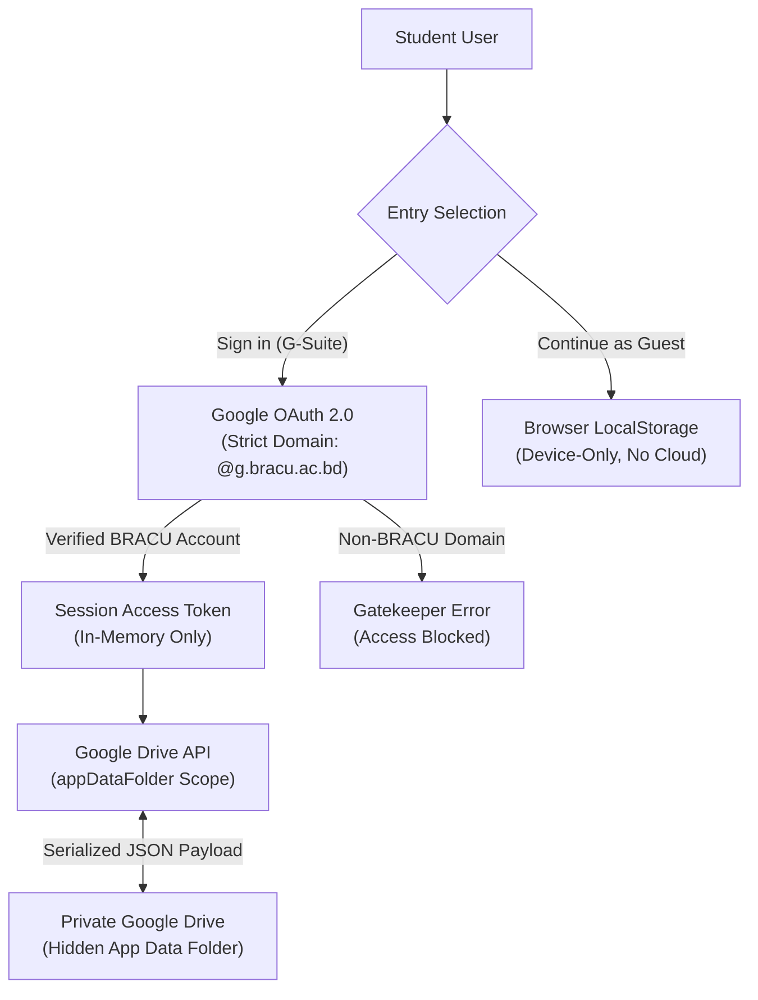

# Flow136 — BRACU CSE Course Tracker & Degree Companion

<div align="center">


**Your BRACU CSE Curriculum, Minus the Complexity.**  
*Interactive Progress Tracker • Prerequisite DAG Validator • CGPA ROI Analyzer • Zero-Database Google Drive Cloud Sync*

[-black?style=for-the-badge&logo=next.js)](https://nextjs.org/)
[](https://react.dev/)
[](https://www.typescriptlang.org/)
[](https://tailwindcss.com/)
[](https://developers.google.com/drive)
[](https://antigravity.google)

</div>

---

## 📌 Table of Contents

- [Overview](#-overview)
- [Key Features](#-key-features)
  - [1. 136-Credit Degree & Prerequisite Graph](#1-136-credit-degree--prerequisite-graph)
  - [2. CGPA Engine & Retake ROI Calculator](#2-cgpa-engine--retake-roi-calculator)
  - [3. GenEd Distribution & Credit Auditing](#3-gened-distribution--credit-auditing)
  - [4. Target GPA Forward Solver](#4-target-gpa-forward-solver)
  - [5. Snapshot Progress Exporter](#5-snapshot-progress-exporter)
- [Authentication & Zero-Database Architecture](#-authentication--zero-database-architecture)
  - [G-Suite Domain Gatekeeper (`@g.bracu.ac.bd`)](#g-suite-domain-gatekeeper-gbracuacbd)
  - [Private Google Drive `appDataFolder` Sync](#private-google-drive-appdatafolder-sync)
  - [Guest Session (Local Storage Only)](#guest-session-local-storage-only)
- [Local Development & Setup](#-local-development--setup)
- [AI-Assisted Development (Antigravity)](#-ai-assisted-development-antigravity)
- [Project Structure](#-project-structure)
- [Disclaimer & License](#-disclaimer--license)

---

## 🚀 Overview

**Flow136** is an open-source, client-first academic degree companion crafted specifically for Computer Science & Engineering (CSE) undergraduate students at **BRAC University (BRACU)**. 

Navigating a 136-credit undergraduate engineering curriculum with intricate prerequisite dependency chains, strict General Education (GenEd) requirements, and retake grade replacement rules can be daunting. Flow136 gives students a visual, interactive dashboard to plan their semesters, validate course prerequisites in real time, forecast CGPAs, and seamlessly back up their academic records directly to their personal Google Drive.

---

## ✨ Key Features

### 1. 136-Credit Degree & Prerequisite Graph
- **Real-Time Dependency Evaluation**: Dynamically validates prerequisite chains (e.g., `CSE110` → `CSE111` → `CSE220` → `CSE221` / `CSE321`).
- **Interactive Course Nodes**: Toggle course completion states (`Completed`, `In-Progress`, `Planned`, or `Untaken`) with immediate feedback on which downstream courses unlock.
- **Visual Semester Roadmaps**: Explore recommended sequence pathways through the interactive **"Feeling lost?"** modal.

### 2. CGPA Engine & Retake ROI Calculator
- **Grade Point & Credit Engine**: Calculates exact semester GPA and cumulative CGPA across all completed courses following the official BRACU 4.0 grading scale.
- **Accurate Retake Replacement**: Correctly computes retake scenarios by replacing earlier course attempts while strictly preserving completed credits and cumulative points.
- **Retake ROI Analyzer**: Simulates grade improvements (e.g., retaking a `C` to an `A`) to display exact numerical CGPA returns before committing to registration.

### 3. GenEd Distribution & Credit Auditing
- Validates required distributions across General Education knowledge streams:
  - **Natural Sciences (Non-Major Lab & Theory)**
  - **Arts & Humanities** (Philosophy, Literature, Ethics)
  - **Social Sciences & Government**
- Tracks remaining elective credits and alerts students when distribution thresholds are met.

### 4. Target GPA Forward Solver
- Input a target graduation CGPA (e.g., `3.50` or `3.80`) and have Flow136 calculate the exact average GPA required across your remaining semester credits to reach your goal.

### 5. Snapshot Progress Exporter
- Export your entire academic progress graph and completed course status as a clean, high-resolution PNG image directly from the browser for offline reference or academic advising sessions.

---

## 🔒 Authentication & Zero-Database Architecture

Flow136 adopts a **Zero-Database Privacy Architecture**. No personal academic data, student IDs, or course plans are stored on third-party servers or databases.



### G-Suite Domain Gatekeeper (`@g.bracu.ac.bd`)
- Integrated using Google OAuth 2.0 with strict domain restriction:
  ```typescript
  // Enforced domain restriction in authorization request
  google.accounts.oauth2.initTokenClient({
    client_id: CLIENT_ID,
    scope: 'https://www.googleapis.com/auth/drive.appdata',
    hd: 'g.bracu.ac.bd', // Strictly restricts authentication to BRACU G-Suite
    callback: handleOAuthResponse,
  });
  ```
- Any attempt to authenticate with a personal `@gmail.com` or unauthorized email domain is immediately intercepted and blocked by the Auth Gatekeeper with an explicit denial alert.

### Private Google Drive `appDataFolder` Sync
- Authenticated students store their entire academic plan inside their personal Google Drive's hidden `appDataFolder` (`https://www.googleapis.com/auth/drive.appdata`).
- **Zero Server Footprint**: Flow136 communicates directly from the client browser to Google's official Drive v3 REST API.
- **Auto-Sync & Manual Backup**: Progress auto-syncs seamlessly, with manual **"Backup to Cloud"** and **"Restore from Cloud"** options available anytime.

### Guest Session (Local Storage Only)
- Students who prefer not to sign in can click **"Continue as Guest (Local Storage Only)"** to immediately access the complete tracker.
- Guest data is preserved in browser `localStorage`.
- A subtle header badge indicates **Guest Mode** with an instant one-click option to upgrade to Google Drive Cloud Sync whenever ready.

---

## 🛠 Local Development & Setup

### Prerequisites
- [Node.js](https://nodejs.org/) (v18.18 or higher recommended)
- `npm`, `pnpm`, or `yarn`

### Installation

1. **Clone the repository**:
   ```bash
   git clone https://github.com/fakekhanabdullah/Flow136-CSE-Course-Tracker.git
   cd Flow136-CSE-Course-Tracker
   ```

2. **Install dependencies**:
   ```bash
   npm install
   ```

3. **Configure Google OAuth (Optional for local testing)**:
   By default, the app is preconfigured with the official client ID for `@g.bracu.ac.bd` domain authentication. You can also configure a custom OAuth client ID via `.env.local` (`NEXT_PUBLIC_GOOGLE_CLIENT_ID`) or by modifying `src/lib/googleDriveSync.ts`.

4. **Run the development server with Turbopack**:
   ```bash
   npm run dev
   ```
   Open [http://localhost:3000](http://localhost:3000) with your browser.

5. **Build for production**:
   ```bash
   npm run build
   ```

---

## 🤖 AI-Assisted Development (Antigravity)

Flow136 was architected and refined using **Google Antigravity (AGY)** pair-programming standards. Development guardrails codified in `AGENTS.md` enforce strict Next.js App Router conventions, zero-database privacy boundaries, and TypeScript type integrity across all changes.

Key custom skills and tools leveraged during development include:
- **`agy-customizations` & `antigravity-guide`**: Managed workspace rules, context-efficient skill loading, and agent pair-programming standards.
- **`ui-ux-optimizer`**: Streamlined responsive mobile scaling, horizontal slider mechanics for semester performance bars, and dark cyber-blue theme aesthetics.
- **`readme-changelog-maintainer`**: Kept documentation, prerequisite datasets, and verification guidelines synchronized with codebase iterations.

This approach enabled rapid, testable feature delivery—such as prerequisite graph solvers, live credit capacity safeguards, and Google Drive cloud synchronization—without manual overhead.

---

## 📂 Project Structure

```
Flow136-CSE-Course-Tracker/
├── .agents/                    # Workspace agent configurations & skills
├── AGENTS.md                   # Workspace rules & Next.js conventions
├── PRIVACY_POLICY.md           # Standalone Privacy Policy document
├── TERMS_OF_SERVICE.md         # Standalone Terms of Service document
├── public/                     # Static assets (favicons, icons, manifest)
├── src/
│   ├── app/
│   │   ├── layout.tsx          # Root Next.js layout, fonts, and Google site verification
│   │   ├── page.tsx            # Main application: Landing hero, Auth Gatekeeper, Degree Dashboard
│   │   ├── privacy/page.tsx    # Dedicated Privacy Policy route & Google Limited Use disclosure
│   │   └── terms/page.tsx      # Dedicated Terms of Service route & academic disclaimers
│   ├── components/             # Reusable UI components (Graph, Modals, Nav, SpeedDial)
│   └── lib/
│       ├── googleDriveSync.ts  # Google OAuth 2.0 & Google Drive v3 REST API persistence
│       └── utils.ts            # Class merging and utility helpers
├── package.json                # Project dependencies and script declarations
├── next.config.ts              # Next.js configuration
├── tsconfig.json               # TypeScript strict configuration
└── README.md                   # Flow136 Comprehensive Documentation
```

---

## 📜 Disclaimer & License

- **Disclaimer**: Flow136 is an independent, open-source tool developed by [Khan Abdullah](https://github.com/fakekhanabdullah) and is **not officially affiliated with or endorsed by BRAC University**. All course codes, credits, and syllabus pathways are derived from public BRACU CSE departmental guidelines.
- **License**: Released under the [MIT License](LICENSE).

---

<div align="center">
  <sub>Crafted with precision for the BRACU CSE Community • Powered by Next.js 16 & Google Antigravity</sub>
</div>
